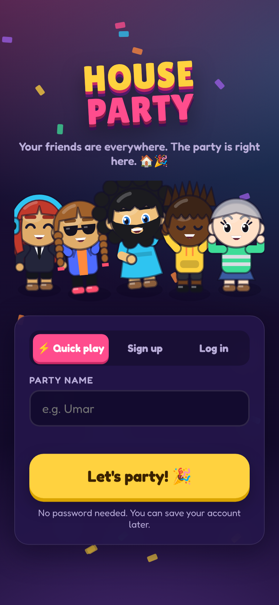
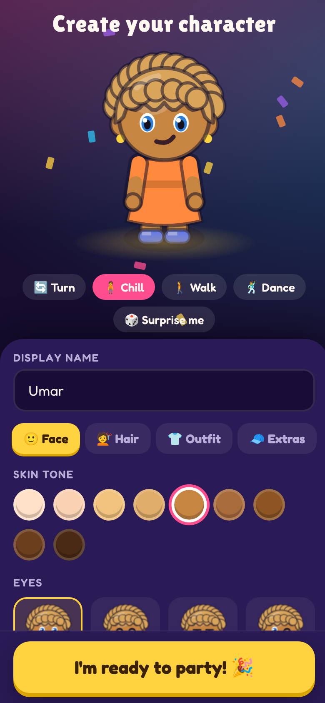
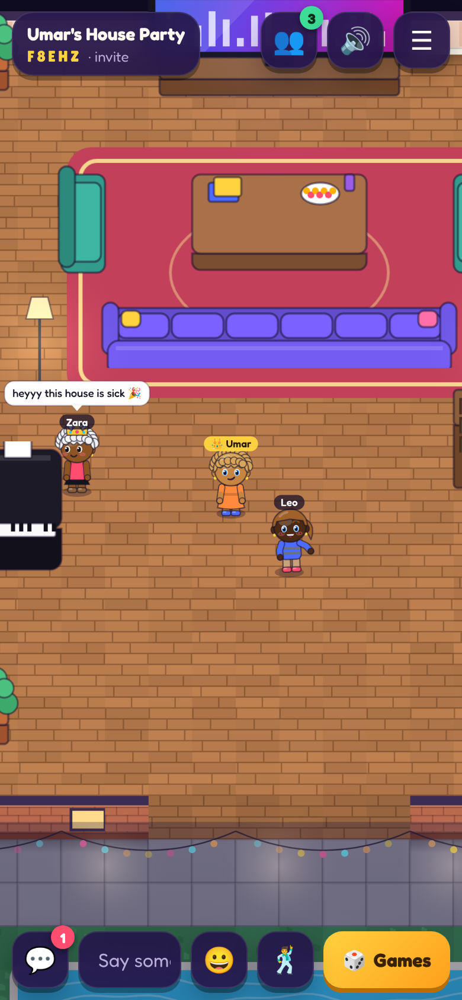
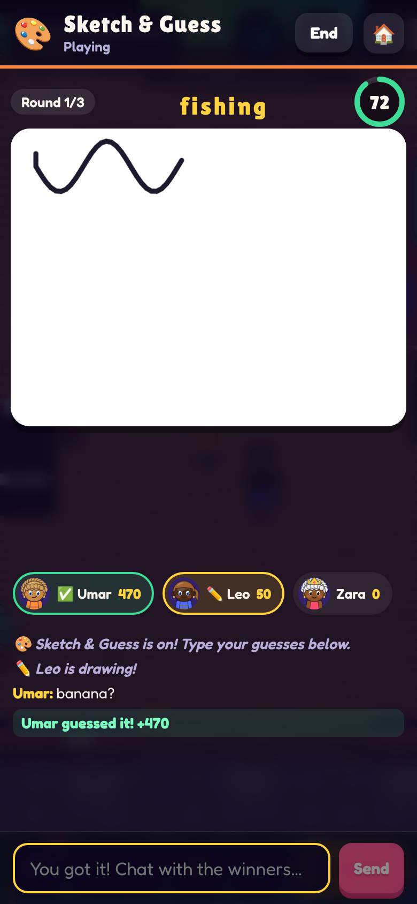
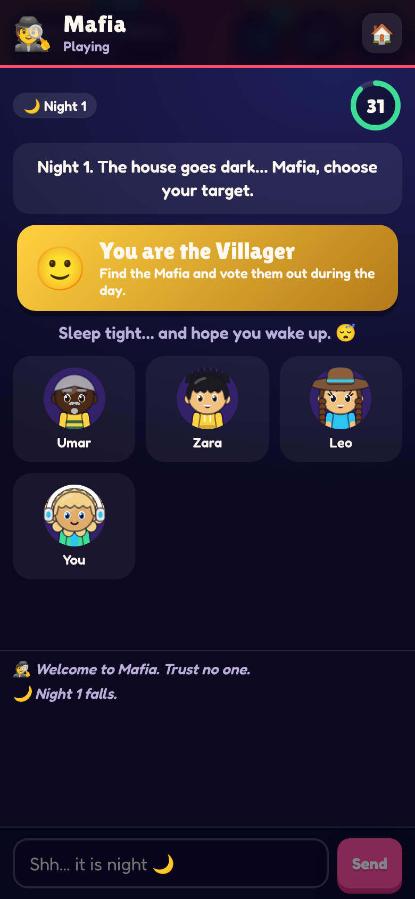
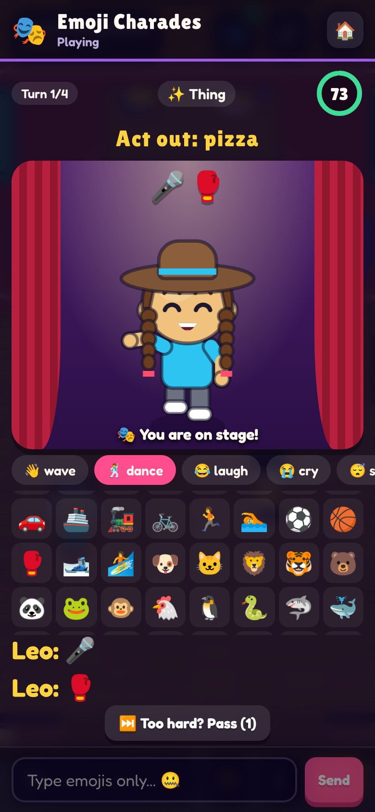

# 🏠🎉 House Party

A virtual house party that runs in the browser. Make a character that looks like you, open a party, send friends a 5‑letter code, and hang out in a shared house: walk around, chat, dance, grab a drink, and play party games together from anywhere in the world. It's built for phones first and works on desktop too.

<p>
  
  
  
  
  
  
</p>

## What's in it

**Characters.** Pick skin tone, 14 hairstyles and colors, eyes, brows, mouth, facial hair, glasses, 9 kinds of headwear, tops, bottoms, shoes, freckles, blush and earrings. You get a live animated preview where you can turn the character, walk, dance and hit "Surprise me". Characters are drawn in code, so every combination works and there are no image files to load.

**The house.** A living room with a TV and sofas, a kitchen with pizza and a fridge, a dance floor with a DJ booth, disco ball and lights that pulse to the beat, a game room, a lounge with a fireplace, and a backyard at night with string lights, a bonfire and a pool you can swim in.
- Tap to walk (with pathfinding) or use WASD/arrow keys. Pinch or scroll to zoom.
- Tap furniture to use it. You can sit on sofas, stools and beanbags, grab drinks and snacks, roast marshmallows, play the piano, or DJ.
- Chat shows up as speech bubbles over people's heads and in a chat panel. You can also whisper (DM) to one person.
- 10 emotes and 6 dance moves.
- Music is generated in the browser (5 tracks). It's loudest on the dance floor and quieter in the other rooms.

**Parties.** Anyone can host. Parties are invite-only by default and can be listed publicly. You can join with a code or an invite link (`/p/CODE`). If a phone drops its connection briefly, the player rejoins without losing their spot. The host can rename the party, make it public or private, and remove people.

**Games.** The server runs all game logic, so players can't see secret info like roles or the word.
| Game | Players | What happens |
|---|---|---|
| 🎨 Sketch & Guess | 2–12 | One person draws and the others race to guess. Drawings sync live, hint letters appear over time, and you get a "so close!" nudge for near misses |
| 🕵️ Mafia | 4–16 | Mafia, Doctor, Detective and Villagers. Night actions, morning narration, day voting, a private chat for the Mafia, and a ghost chat for eliminated players |
| 🎭 Emoji Charades | 2–12 | The actor can only use emojis and their character's poses (dance, cry, fly, sleep…) |
| 👀 Who's the Imposter? | 3–12 | Everyone gets the secret word except one player. Players give one-word clues, then vote. If the Imposter is caught, they get one last guess at the word |

Each game has a lobby that the whole party is invited to, a how-to-play screen, scores, a results podium and a rematch button. Everyone's games played and wins are saved to their profile.

**Accounts.** Use quick play (just a name) or sign up with a username and password. A guest can save their account later and keep their character and stats.

## Run it

```bash
npm install
npm run dev        # server on :3001, app on http://localhost:5173
```

For production, it runs as one process on one port:

```bash
npm run build
npm start          # serves the app + API + websockets on $PORT (default 3001)
```

Or use Docker: `docker build -t house-party . && docker run -p 3001:3001 -v hp-data:/data house-party`

Environment variables: `PORT`, `DATA_DIR` (where users are stored, default `./data`), `AUTH_SECRET` (set this in production), `CORS_ORIGIN`.

### Deploy on Railway

The repo is ready for Railway: `railway.json` builds from the `Dockerfile` and health-checks `/api/health`.

1. In Railway, create a project and pick **Deploy from GitHub repo**, then choose this repo.
2. On the service, add a **Volume** mounted at `/data`. This is where accounts are stored. Without it, everyone's account is wiped on every deploy.
3. Under **Variables**, add `AUTH_SECRET` with a long random value (for example the output of `openssl rand -hex 32`). Railway sets `PORT` for you.
4. Under **Settings → Networking**, click **Generate Domain** to get a public URL.

Keep the service at **1 replica**. Parties live in the server's memory, so friends on different replicas wouldn't see each other.

## Tests

```bash
npm test                 # game engine unit tests (vitest)
npm run typecheck
node dev/e2e.mjs         # 3 browsers: sign up → create character → host/join → chat → Sketch & Guess
node dev/e2e-games.mjs   # 4 browsers: Mafia, Emoji Charades, Imposter
```

The e2e scripts need the dev servers running. They save screenshots to `screenshots/`.

## How it's built

```
src/
  shared/    types + socket protocol, avatar model, house map + A* pathfinding
  server/    Express + Socket.IO
    auth.ts      signup/login/guest, HMAC tokens, scrypt passwords
    store.ts     JSON-file user store (swap for a DB later)
    parties.ts   party rooms, movement relay (15Hz batched), chat, game sessions
    games/       draw, mafia, charades, imposter engines (one per-player view each)
  client/    React + a canvas game engine
    world/       World.ts (camera, input, y-sorted rendering, lighting), avatarRender.ts, sprites.ts, tiles.ts
    games/       one UI per game + shared lobby/results overlay
    sound.ts     WebAudio music sequencer + sound effects
```

## Ideas for next steps

- Voice chat with proximity (WebRTC) so people can talk when they stand close together
- More games (Trivia, Would You Rather, Two Truths & a Lie, Spyfall)
- More rooms and themes (rooftop, beach house), and letting hosts decorate
- Postgres/Redis to persist parties and run more than one server
